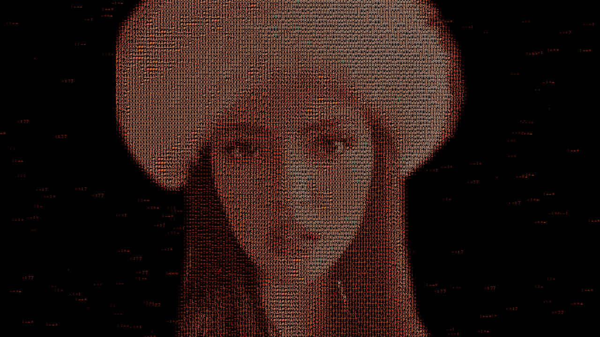

# Da Irina ao Kali Linux

**Como eu construo uma animação ASCII em Python, passo a passo.**



Neste projeto, eu transformo uma fotografia da Irina em um retrato feito de caracteres. Depois, faço os olhos piscarem, aproximo a câmera da íris, formo um coração pulsante e reorganizo as letras no dragão do Kali Linux.

Tudo acontece em tempo real, em uma janela horizontal. A foto fornece a referência de luz e de forma; o que aparece na tela são caracteres e partículas calculados pelo código.

A sequência completa dura **22 segundos**. Na configuração padrão, eu trabalho com **19.170 caracteres**, em uma janela de **1280 × 720**, com limite de atualização de **60 FPS**.

## Para executar

Uso Python **3.9 a 3.12**. Na pasta do projeto:

```bash
python3 -m venv .venv
.venv/bin/python -m pip install -r requirements.txt
.venv/bin/python main.py
```

No macOS, também posso abrir **Iniciar Irina.command** com duplo clique. Se o arquivo baixado estiver sem permissão de execução, libero essa permissão uma vez:

```bash
chmod +x "Iniciar Irina.command"
```

Os comandos acima usam os caminhos do ambiente virtual no macOS/Linux. No Windows, o interpretador equivalente fica em `.venv\Scripts\python.exe`.

## 1. Eu preparo a fotografia e as bibliotecas

Começo pela imagem em `assets/irina.jpg`. Uso **OpenCV** para ler e amostrar a foto, **NumPy** para calcular posições e máscaras e **Pygame** para desenhar as letras e controlar a janela.

Em `Animation._load_portrait()`, verifico se o arquivo existe antes de continuar:

```python
raw = cv2.imread(str(photo))
if raw is None:
    raise FileNotFoundError(f"Fotografia não encontrada: {photo}")

self.photo = cv2.resize(raw, (707, 1536))
gray = cv2.cvtColor(self.photo, cv2.COLOR_BGR2GRAY)
```

Eu normalizo a imagem para **707 × 1536 em memória**, porque as coordenadas dos olhos e do chapéu foram ajustadas nesse espaço. O arquivo original permanece intacto.

Depois, misturo um pouco de contraste local com a luminosidade original e aplico uma nitidez leve. Assim consigo destacar os olhos, os lábios e os fios de cabelo sem transformar todas as áreas claras em uma mancha branca.

**Onde está:** [`ascii_engine.py`](ascii_engine.py), em `Animation._load_portrait()`.

## 2. Eu separo a Irina do fundo

A fotografia também contém o ambiente e elementos da interface do celular. Para deixar o retrato sobre fundo preto, desenho uma **máscara de silhueta**.

Uma máscara é uma imagem que indica onde o desenho pode aparecer: branco preserva a região, preto remove e os valores intermediários suavizam a borda.

```python
mask = np.zeros(self.photo.shape[:2], np.uint8)
cv2.fillPoly(mask, [outline], 255)
self.silhouette = cv2.GaussianBlur(mask, (0, 0), 4)
```

`outline` reúne pontos medidos na foto. A curva lateral do chapéu faz parte desse contorno: se eu recortar essa região com pontos errados, as letras também vão formar um chapéu incompleto.

Esse recorte é uma calibração manual para esta fotografia, não uma segmentação automática de qualquer pessoa.

**Onde está:** [`ascii_engine.py`](ascii_engine.py), em `Animation._build_silhouette()`.

## 3. Eu transformo a luz da foto em letras

Uma fotografia tem muitos pixels. Para reconstruí-la com texto, distribuo células na tela e consulto a luminosidade da foto correspondente a cada posição.

Com `--cell 6`, a grade padrão tem **213 colunas e 90 linhas**. Cada uma das 19.170 posições pode receber uma letra, um número ou um símbolo de `CHARS`:

```python
CHARS = "0123456789ABCDEFGHIJKLMNOPQRSTUVWXYZ@#$%&*+:."
```

Só escolher um caractere aleatório para cada célula não basta. Um `@` ocupa mais área que um `.` e, mesmo com a mesma cor, ilumina mais a tela. Essa diferença pode criar ruído sobre o rosto.

Por isso, eu meço a área iluminada de cada letra e calibro sua cor. De forma simplificada:

```text
Luz média da célula ≈ área iluminada da letra × luminosidade da cor
```

A partir dessa relação, escolho caracteres com densidade adequada e compenso sua intensidade. A variedade continua existindo, mas passa a respeitar as sombras e os detalhes da fotografia.

A paleta começa em cobre, laranja e creme. Durante a formação do Kali, ela muda gradualmente para o azul.

**Onde está:** `Animation.portrait()` em [`ascii_engine.py`](ascii_engine.py) e `Renderer._build_glyph_templates()` / `_calibrate_tones()` em [`live_app.py`](live_app.py).

## 4. Eu construo o retrato letra por letra

Para o rosto se formar aos poucos, cada partícula recebe um instante de entrada, guardado em `birth`, e uma posição de origem, guardada em `spawn`.

```python
reveal = ease((t - self.birth) / 0.6)
positions = (
    self.spawn * (1 - reveal[:, None])
    + self.grid * reveal[:, None]
)
```

Quando `reveal` está perto de zero, a letra ainda está na posição de origem. Quando chega a um, ela está encaixada na grade do retrato. A luminosidade também aumenta durante essa chegada.

Eu combino a altura da célula com atrasos individuais para criar uma onda de construção. Várias letras entram ao mesmo tempo; não é uma digitação serial de um único caractere por vez.

Uso uma semente aleatória fixa para repetir as mesmas trajetórias quando reinicio a animação.

**Onde está:** [`ascii_engine.py`](ascii_engine.py), na preparação de `Animation` e em `_portrait_state()`.

## 5. Eu faço a Irina piscar

A piscada acontece perto de **3,75 segundos**. Primeiro, calculo um valor que sobe até o fechamento e volta a zero:

```python
blink = math.exp(-(((t - 3.75) / 0.12) ** 2))
```

Depois, delimito cada olho com uma elipse. Conforme `blink` aumenta, substituo a luminosidade da abertura do olho pela luminosidade da pele vizinha e escureço uma pequena linha para sugerir as pálpebras fechadas.

As posições dos olhos foram medidas na foto normalizada: aproximadamente `(212, 518)` e `(351, 511)`.

É uma simulação local de piscada. Eu não uso outra fotografia nem um rastreador facial para gerar o movimento.

**Onde está:** [`ascii_engine.py`](ascii_engine.py), dentro de `Animation.portrait()`.

## 6. Eu aproximo a câmera do rosto e do olho

Para fazer o zoom, mantenho a grade de letras na tela e mudo o ponto da fotografia consultado por cada célula:

```python
center, mag = self.camera(t)
xy = center + (self.grid - self.center) / mag
```

`center` é o ponto observado na foto, e `mag` é a ampliação. Quanto maior a ampliação, menor é a região da imagem distribuída pela tela. `cv2.remap()` faz essa amostragem.

A câmera passa do retrato para o rosto e termina no olho à esquerda da imagem. A ampliação é exponencial, com aceleração e desaceleração suaves.

Para suavizar os movimentos, uso esta curva de quinta ordem:

```python
def ease(x):
    x = np.clip(x, 0.0, 1.0)
    return x * x * x * (x * (6 * x - 15) + 10)
```

Ela começa e termina sem uma mudança brusca de velocidade. O zoom amplia os detalhes que já existem na foto; não cria uma nova íris ou um novo rosto.

**Onde está:** [`ascii_engine.py`](ascii_engine.py), em `ease()`, `Animation.camera()` e `portrait()`.

## 7. Eu desenho o coração com matemática

O coração não depende de uma imagem pronta. Eu calculo seu contorno com uma curva paramétrica:

```text
x(a) = 16 × sen(a)³

y(a) = 13 × cos(a) − 5 × cos(2a) − 2 × cos(3a) − cos(4a)
```

Ao percorrer `a` de zero a `2π`, obtenho os pontos do coração. Eu os posiciono no centro da tela, preencho a máscara e distribuo as células de destino dentro dela.

A borda recebe mais luz que o miolo. Para criar o batimento, aumento e reduzo levemente a escala ao redor do centro, usando uma função seno. Esse movimento chega parado às transições para não dar trancos.

As partículas que compunham o olho viajam até essas posições entre **9 e 11,5 segundos**. O coração pulsa entre **11,5 e 14 segundos**.

**Onde está:** [`ascii_engine.py`](ascii_engine.py), em `make_shape()`, `_eye_to_heart_state()` e `_heart_state()`.

## 8. Eu transformo o coração no dragão do Kali Linux

Para preservar o desenho do símbolo, uso o PNG transparente em `assets/kali-dragon.png`. Leio seu **canal alfa**, que indica quais partes pertencem à figura, e calculo as posições onde as letras devem chegar.

A base da transformação está neste trecho:

```python
progress = float(ease((t - 14) / 5))
positions = self.heart * (1 - progress) + self.dragon * progress
```

No início, as partículas estão no coração. Ao final, estão no dragão. Sobre essa interpolação, acrescento deslocamentos curvos para que elas atravessem a tela por trajetórias mais orgânicas.

Também associo as posições por vizinhança espacial, usando uma ordenação Morton. Isso ajuda a aproximar regiões correspondentes das figuras. Não é um cálculo de caminho mínimo para cada letra.

Durante a compactação, partículas excedentes perdem luminosidade para que várias letras não disputem a mesma célula. A cor acompanha a transformação até o azul.

O resultado é uma reorganização de partículas durante **cinco segundos**, e não apenas uma dissolução entre duas imagens.

**Onde está:** [`ascii_engine.py`](ascii_engine.py), em `_order()`, `make_shape()` e `_heart_to_dragon_state()`.

## 9. Eu desenho tudo em tempo real

Em vez de exportar os quadros para um vídeo, eu os apresento em uma janela Pygame. A cada atualização, leio os controles, avanço o relógio e desenho a cena correspondente ao tempo atual.

Este é um resumo do ciclo de execução:

```python
for event in pygame.event.get():
    self.handle_event(event)

self.playback.update(delta)
frame = self.renderer.draw(self.playback.time)
self.present(frame)
delta = clock.tick(self.args.fps) / 1000
```

`delta` representa o intervalo entre as atualizações, em segundos. A duração da animação é guiada por esse relógio, não pela contagem de quadros. Em uma máquina mais lenta, o movimento pode ter menos atualizações, mas a sequência continua usando a mesma linha do tempo.

Para economizar processamento, preparo as letras coloridas uma vez e as guardo em um **atlas**. Enquanto o retrato está montado, organizo essas letras em bloco com NumPy. Durante a construção e as transformações, desenho as partículas individualmente.

Os brilhos em forma de estrela usam o caractere `+`. O brilho suave ao redor das figuras vem da luz das próprias letras.

**Onde está:** [`live_app.py`](live_app.py), nas classes `Renderer` e `App`, e [`ascii_engine.py`](ascii_engine.py), em `Playback`.

## 10. Como eu organizo a sequência

| Tempo | O que acontece |
|---|---|
| 0–4,5 s | Construção do retrato ASCII; piscada perto de 3,75 s |
| 4,5–6,3 s | Aproximação do rosto |
| 6,3–9 s | Zoom até o olho |
| 9–11,5 s | Partículas do olho formam o coração |
| 11,5–14 s | Coração pulsante |
| 14–19 s | Coração se reorganiza no dragão do Kali |
| 19–22 s | Dragão formado e revelação do título |

A sequência repete ao chegar ao final. Com `--once`, ela pausa no último desenho.

## 11. Como eu navego e personalizo

| Controle | Ação |
|---|---|
| Espaço | Pausar ou continuar |
| R | Reiniciar a construção |
| ← / → | Voltar ou avançar um segundo |
| 1 / 2 / 3 / 4 / 5 | Ir para retrato, rosto, olho, coração ou Kali |
| + / − | Ajustar a velocidade entre 0,25× e 2× |
| F | Alternar tela cheia e janela |
| H | Mostrar ou ocultar os controles |
| Esc | Sair |
| Clique na barra inferior | Escolher um instante da animação |

Para mudar o aspecto das letras ou o desempenho, uso os argumentos do programa:

```bash
# Letras maiores
.venv/bin/python main.py --cell 12

# Equilíbrio entre detalhe e desempenho
.venv/bin/python main.py --cell 8

# Janela menor, com limite de 30 FPS
.venv/bin/python main.py --width 960 --height 540 --fps 30

# Começar pelo olho e pausar no final
.venv/bin/python main.py --start 8.5 --once

# Outra distribuição reprodutível de caracteres
.venv/bin/python main.py --seed 17
```

Para outra fotografia, `--photo` muda o arquivo de entrada, mas também preciso recalibrar a silhueta, os olhos e o enquadramento no código. `--logo` aceita outra máscara PNG com transparência.

## 12. Como eu organizo e verifico o código

| Arquivo | Responsabilidade |
|---|---|
| [`main.py`](main.py) | Ponto de entrada do programa |
| [`ascii_engine.py`](ascii_engine.py) | Simulação, relógio, câmera, máscaras e partículas |
| [`live_app.py`](live_app.py) | Letras em cache, janela e controles |
| [`requirements.txt`](requirements.txt) | Dependências para executar |
| [`test_realtime.py`](test_realtime.py) | Construção, piscada, continuidade e controles |
| [`test_renderer_quality.py`](test_renderer_quality.py) | Luminosidade das letras e equivalência dos caminhos de desenho |
| [`render_video.py`](render_video.py) | Exportador opcional, separado da animação ao vivo |

Os exemplos deste README explicam partes do projeto. Eles usam variáveis e métodos das respectivas classes; não são programas completos para executar isoladamente.

Para conferir o projeto:

```bash
.venv/bin/python -m pip check
.venv/bin/python -m unittest -v

# Desenha as fases e testa os controles sem abrir uma janela
.venv/bin/python main.py --check

# Verifica o estilo do código
.venv/bin/python -m pip install -r requirements-dev.txt
.venv/bin/ruff check .
.venv/bin/ruff format --check .
```

`--check` salva imagens e um relatório em `output/live_checks/`. A velocidade medida nesse teste é a de desenho em memória; não inclui a apresentação no monitor. O limite de 60 FPS também não garante esse desempenho em qualquer computador.

## O que eu posso evoluir

Posso substituir a calibração manual por detecção de pontos faciais, refinar a deformação das pálpebras e melhorar a associação entre partículas nas formas mais complexas. Para outras fotos, também posso automatizar a separação da pessoa do fundo.

A base já permite consultar qualquer instante diretamente. Isso facilita pausar, repetir uma transição e ajustar o efeito sem precisar gerar um vídeo inteiro.

## Materiais e referências

A fotografia original fica em [`assets/irina.jpg`](assets/irina.jpg), com os arquivos recebidos preservados em [`original/`](original/). As referências de estilo estão em [`assets/references/`](assets/references/).

O dragão vem do [Kali Linux Press Pack oficial](https://gitlab.com/kalilinux/documentation/press-pack/-/tree/main/Kali/Logomark). A documentação do exportador opcional está em [`docs/legacy/`](docs/legacy/).

A fonte preferida é Menlo no macOS, DejaVu Sans Mono no Linux e Consolas no Windows, com uma fonte interna como alternativa. O desenho das letras pode variar entre sistemas.

A foto e as referências visuais fazem parte deste projeto. A publicação do código não transfere direitos sobre a imagem da pessoa fotografada nem sobre as marcas utilizadas.
